# csiro-image2biomass

Predicting five pasture-biomass quantities from top-view photos with frozen vision backbones (DINOv3 / SigLIP) and light regression heads.
The repository focuses on evaluation design: date-grouped cross-validation, four ways to respect the additive relations between targets, and OOF-based ensembling.
Everything runs from three commands once the competition data is on disk; a synthetic dataset lets the whole pipeline run on a CPU without it.

[](https://github.com/nuummm/csiro-image2biomass/actions/workflows/ci.yml)
[](LICENSE)

## TL;DR

- **Features**: frozen DINOv3 ViT-L/16 (or SigLIP so400m) embeddings of the left and right halves of each image plus their mirror images, averaged per image.
- **Heads**: Scaler + PCA fitted inside each fold, then Ridge (alpha by leave-one-out on the training part) or LightGBM (early stopping on a grouped hold-out).
- **CV**: random KFold vs. `GroupKFold` on `Sampling_Date` (and month × State), each repeated over several seeds, so the gap between the two is reported with a spread.
- **Outputs**: 5 independent models / sum of 3 components / differences of the top 3 / weighted NNLS projection onto the feasible set.
- **Results**: not filled in yet. [`reports/results.md`](reports/results.md) is generated by `scripts/run_all.py` from the competition data, and only numbers produced by this code will appear there.

## Task

[CSIRO – Image2Biomass Prediction](https://www.kaggle.com/competitions/csiro-biomass) (Kaggle, Oct 2025 – Jan 2026). Each image shows a 70 cm × 30 cm pasture quadrat (about 2000 × 1000 px). For every image, predict dry biomass in grams for

| target | meaning | metric weight |
|---|---|---|
| `Dry_Green_g` | green vegetation excluding clover | 0.1 |
| `Dry_Dead_g` | dead material | 0.1 |
| `Dry_Clover_g` | clover | 0.1 |
| `GDM_g` | green dry matter = Green + Clover | 0.2 |
| `Dry_Total_g` | total = GDM + Dead | 0.5 |

Files are in long format: one row per `(image, target)` with `sample_id = <image_id>__<target_name>`. The training CSV also has `Sampling_Date`, `State`, `Species`, NDVI and plate height; the test CSV has only the image path, so these columns are used for grouping and EDA but never as model inputs. The public training split has 357 images; the hidden test set has more than 800.

**Metric** (Evaluation page). A single R² over *all* rows together, each row weighted by its target, with the global weighted mean as the baseline:

$$
R^2_w = 1 - \frac{\sum_j w_j (y_j - \hat y_j)^2}{\sum_j w_j (y_j - \bar y_w)^2},
\qquad \bar y_w = \frac{\sum_j w_j y_j}{\sum_j w_j}.
$$

This is not the average of per-target R² values: because the baseline is shared, targets with large values (Total) dominate both the numerator and the denominator. [`metric.py`](src/biomass/metric.py) implements this definition and a test checks it against the long-format formula.

## Pipeline

```mermaid
flowchart LR
    A[image 2000x1000] --> B[left / right halves<br/>+ horizontal flips]
    B --> C[frozen backbone<br/>CLS + mean patch token]
    C --> D[mean over views<br/>= image embedding]
    D --> E[fold-local<br/>Scaler + PCA]
    E --> F[Ridge / LightGBM<br/>raw or log1p target]
    F --> G[inverse transform<br/>to grams]
    G --> H[output formulation<br/>independent / sum / diff / NNLS]
    H --> I[OOF score<br/>+ test prediction]
    I --> J[ensemble<br/>mean / best / cross-fit NNLS]
```



## CV design

The training images come from a limited number of sampling events (date × site). Photos from the same event share light, season and pasture state, so a random split puts near-duplicates on both sides and is expected to look better than it should. [`folds.py`](src/biomass/folds.py) provides

- `kfold` – shuffled KFold (reference point),
- `group_date` – every `Sampling_Date` stays inside one fold,
- `group_month_state` – coarser groups (month × State), used only when there are enough groups.

Grouped folds are built by visiting groups in a seeded random order and assigning each to the currently smallest fold; the function asserts that no group spans two folds. Every scheme is repeated over the seeds in `configs/base.yaml`, and the report gives mean ± std over seeds as well as over individual folds. `scripts/inspect_data.py` prints the number of groups before any of this is trusted.

Leakage control: the scaler, PCA, Ridge's alpha search and LightGBM's early stopping only see the training part of each fold. `tests/test_no_leak.py` checks that the fitted scaler mean equals the training-part mean in every fold.

## Output formulation

All five targets are determined by three non-negative components $c = (\text{Green}, \text{Dead}, \text{Clover})$ through $y = Ac$:

$$
A = \begin{pmatrix} 1&0&0\\ 0&1&0\\ 0&0&1\\ 1&0&1\\ 1&1&1 \end{pmatrix}.
$$

| formulation | fitted targets | how the five outputs are formed | identities hold? |
|---|---|---|---|
| `independent` | all 5 | clip at 0 | no |
| `sum` | Green, Dead, Clover | $\hat y = A\,\max(\hat c, 0)$ | yes |
| `diff` | Total, GDM, Green | Clover = GDM − Green, Dead = Total − GDM (negative differences set to 0, parents rebuilt) | yes |
| `nnls` | all 5 | $\hat c = \arg\min_{c \ge 0} \lVert W^{1/2}(Ac - \hat y)\rVert^2$, output $A\hat c$ | yes |

The trade-off: `sum` accumulates the component errors into Total (weight 0.5), `diff` pushes the errors of large quantities into the small ones, and `nnls` uses all five predictions. With $W$ equal to the metric weights, the NNLS step finds the feasible point that is closest in exactly the weighted squared error that enters the metric's residual term. Formulations are applied on the gram scale, after `expm1` when the model was trained on `log1p` targets ([`constraints.py`](src/biomass/constraints.py); tests check the identities to 1e-6 and that a feasible input is left unchanged).

## Target space and ensembling

- **Target space**: `raw` or `log1p`. The targets are skewed, which favours `log1p` for fitting, but the metric is on the raw scale and dominated by large Total values, where `log1p` models tend to under-predict. Both are evaluated on OOF predictions rather than chosen in advance.
- **Ensembling** ([`ensemble.py`](src/biomass/ensemble.py)): simple mean, best single run, and *cross-fit* NNLS stacking — weights are learned on the other folds' OOF predictions and applied to the held-out fold, so the reported ensemble score is not fitted on the rows it is evaluated on. One non-negative weight per model is shared across the five targets; a non-negative combination of predictions that satisfy the identities still satisfies them, so no re-projection is needed. The fold-to-fold spread of the weights is reported too: if stacking does not clearly beat the mean, the mean is the safer choice.

## Ablations

`scripts/run_all.py` starts from `configs/base.yaml` and changes one setting at a time:

| axis | levels |
|---|---|
| CV scheme | kfold / group_date / group_month_state |
| backbone | dinov3_large / siglip_so400m / color_stats (hand-crafted colour baseline) |
| head | ridge / lgbm |
| target space | raw / log1p |
| output formulation | independent / sum / diff / nnls |
| ensemble | mean / best / cross-fit NNLS |

## Reproduce

```bash
uv sync --extra embed            # torch, timm, transformers for feature extraction
# macOS only: LightGBM needs OpenMP (`brew install libomp`)
```

Download the data from the competition page after accepting its rules and point the code at it (the directory with `train.csv`, `test.csv`, `train/`, `test/`):

```bash
export BIOMASS_DATA_DIR=/path/to/csiro-biomass
uv run python scripts/inspect_data.py                  # group counts, identity residuals
uv run python scripts/extract_embeddings.py            # 1. features -> emb/<backbone>/
uv run python scripts/run_cv.py                        # 2. CV -> runs/<name>/
uv run python scripts/make_submission.py --runs runs/dinov3_large-group_date-ridge-log1p-nnls   # 3.
uv run python scripts/run_all.py                       # all ablations -> reports/results.md
```

The device is picked automatically (CUDA, then Apple MPS, then CPU) and can be forced with `--device` or `BIOMASS_DEVICE`. Settings are changed with `--set`, e.g. `--set backbone=siglip_so400m --set model.head=lgbm`. Running on Kaggle (internet disabled) is described in [`docs/kaggle.md`](docs/kaggle.md).

**Without the competition data**:

```bash
uv sync
uv run python scripts/make_synthetic_data.py --out data/synthetic
export BIOMASS_DATA_DIR=data/synthetic
uv run python scripts/extract_embeddings.py --set backbone=color_stats
uv run python scripts/run_all.py --set backbone=color_stats --set model.pca_components=8 --report-dir runs/synthetic_report
```

The synthetic images are noise whose colours follow made-up targets; the scores they produce say nothing about the real task.

**Tests**: `uv run pytest` (CPU only, synthetic inputs). The transformer tests build DINOv3 and SigLIP with random weights (`pretrained=False`), so nothing is downloaded; they are skipped when the `[embed]` extra is not installed, as in CI.

**Reproducibility boundary**: seeds fix the folds, PCA and LightGBM, and `uv.lock` pins the Python packages. Embeddings can still differ slightly across hardware and fp16 (CUDA) vs fp32 (MPS / CPU), and the backbone weights are fetched from their publishers rather than shipped here.

## Background

I won a bronze medal in Kaggle CSIRO Image2Biomass (253rd of 3,805 teams, private LB 0.61366, solo). This repository is an independent reimplementation written from scratch after the competition, so its results differ from that submission.

## Limitations and future work

- Features are frozen; fine-tuning the backbone was out of scope.
- No use of text prompts / image–text similarity from SigLIP; only the vision tower is used.
- No PLS, Gaussian-mixture features, CatBoost, or hurdle models for the many zero-clover images.
- No target-specific loss weighting, pseudo-labelling, or test-time image editing.
- Hyperparameters (PCA size, alpha grid, LightGBM settings) are reasonable defaults, not tuned.
- Scores will be reported only after running on the competition data; until then the README makes no performance claims.

## Project layout

```
configs/base.yaml          default experiment (every key can be overridden with --set)
src/biomass/
  data.py                  long <-> wide, sample_id, paths from config / $BIOMASS_DATA_DIR
  folds.py                 KFold / date-grouped / month x State folds, repeated over seeds
  metric.py                global weighted R^2 (competition metric)
  constraints.py           independent / sum / diff / NNLS output formulations
  embed.py                 views, frozen DINOv3 (timm) / SigLIP (transformers), device choice
  cv.py                    fold-local preprocessing, Ridge / LightGBM, OOF + test predictions
  ensemble.py              mean / best / cross-fit NNLS
  submit.py                long-format submission + validation
  pipeline.py, config.py   glue for the scripts
  synthetic.py             fake dataset for tests and dry runs
scripts/                   inspect_data, extract_embeddings, run_cv, make_submission, run_all
tests/                     metric, constraints, folds, no_leak, ensemble, submit, embed, smoke
reports/results.md         filled in by scripts/run_all.py
```

## License and third-party notices

Code: MIT, see [LICENSE](LICENSE). References for the methods are in [CREDITS.md](CREDITS.md).

- **Data**: the competition data (CC BY-SA 4.0, also subject to the competition rules) is not included. Dataset paper: Liao et al., *Estimating Pasture Biomass from Top-View Images: A Dataset for Precision Agriculture*, arXiv:2510.22916 (2025).
- **DINOv3** weights are released by Meta under the DINOv3 License and are not included or redistributed here; neither are embeddings computed from them. Work that uses them should acknowledge DINOv3 as the license requires.
- **SigLIP** (`google/siglip-so400m-patch14-384`) is released under Apache-2.0; weights are not included.
- Libraries are used under their own licenses (timm and transformers: Apache-2.0; scikit-learn: BSD-3-Clause; LightGBM: MIT; SciPy, NumPy, pandas: BSD-3-Clause).

## 日本語要約

牧草の真上写真から 5 種類のバイオマス量を推定する Kaggle コンペ（CSIRO Image2Biomass）を題材に、凍結した DINOv3 / SigLIP の埋め込みと軽い回帰ヘッドで学習パイプラインを一から実装したものです。日付でグループ化した CV と通常の KFold の差、ターゲット間の加法関係の 4 通りの扱い方、OOF に基づくアンサンブルを比較できるようにしています。コンペでは銅メダル（253 位 / 3,805 チーム、private 0.61366、個人参加）でしたが、この repo はコンペ後に書き直した独立実装で、結果はコンペ提出とは異なります。数値は実データで `scripts/run_all.py` を実行した後に `reports/results.md` に載せます。
