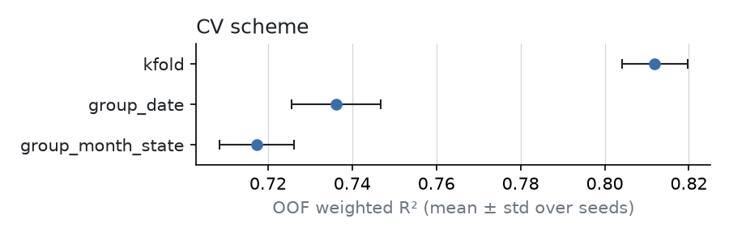
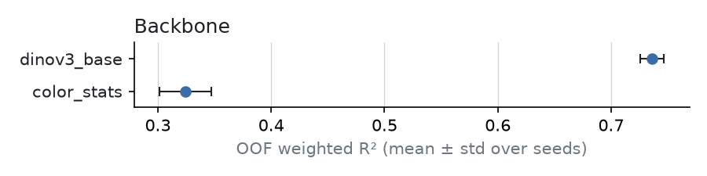
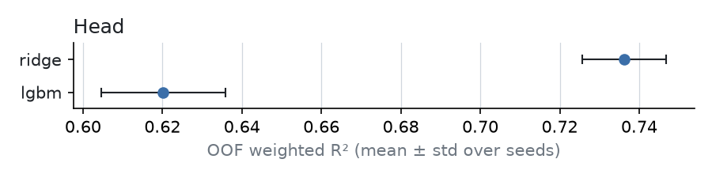
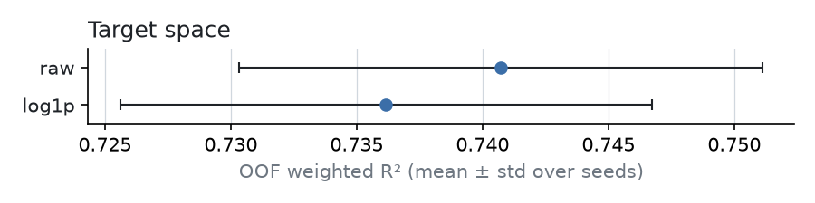
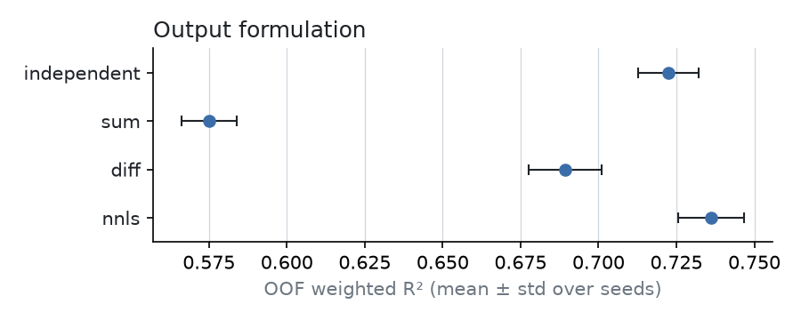
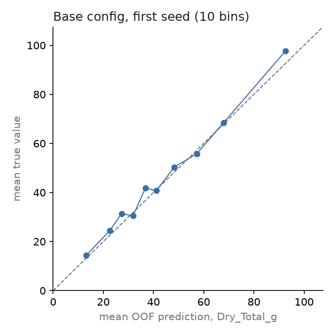

# Results

Generated by `scripts/run_all.py`. Scores are the competition metric (global weighted R²)
on out-of-fold predictions, mean ± std over the CV seeds of `configs/base.yaml`.
*fold R²* is the same metric per validation fold (mean ± std over all folds and seeds);
*R² Total* is the plain R² of `Dry_Total_g`, averaged over seeds.

Base configuration: `dinov3_base-group_date-ridge-log1p-nnls`, 5 folds, seeds [0, 1, 2].

## CV scheme

| cv.scheme | OOF R² | fold R² | R² Total |
|---|---|---|---|
| kfold | 0.8119 ± 0.0078 | 0.8149 ± 0.0368 | 0.7451 |
| group_date | 0.7362 ± 0.0106 | 0.7267 ± 0.0502 | 0.6577 |
| group_month_state | 0.7173 ± 0.0088 | 0.6897 ± 0.0679 | 0.6594 |

## Backbone

| backbone | OOF R² | fold R² | R² Total |
|---|---|---|---|
| dinov3_base | 0.7362 ± 0.0106 | 0.7267 ± 0.0502 | 0.6577 |
| color_stats | 0.3243 ± 0.0231 | 0.3216 ± 0.1092 | 0.1079 |

## Head

| model.head | OOF R² | fold R² | R² Total |
|---|---|---|---|
| ridge | 0.7362 ± 0.0106 | 0.7267 ± 0.0502 | 0.6577 |
| lgbm | 0.6202 ± 0.0156 | 0.6203 ± 0.0788 | 0.5067 |

## Target space

| model.target_space | OOF R² | fold R² | R² Total |
|---|---|---|---|
| raw | 0.7407 ± 0.0104 | 0.7185 ± 0.0604 | 0.6535 |
| log1p | 0.7362 ± 0.0106 | 0.7267 ± 0.0502 | 0.6577 |

## Output formulation

| model.formulation | OOF R² | fold R² | R² Total |
|---|---|---|---|
| independent | 0.7224 ± 0.0098 | 0.7111 ± 0.0529 | 0.6605 |
| sum | 0.5751 ± 0.0089 | 0.5616 ± 0.1309 | 0.4168 |
| diff | 0.6892 ± 0.0117 | 0.6716 ± 0.0979 | 0.6205 |
| nnls | 0.7362 ± 0.0106 | 0.7267 ± 0.0502 | 0.6577 |

## Per-target R² (base config, first seed)

| Dry_Green_g | Dry_Dead_g | Dry_Clover_g | GDM_g | Dry_Total_g |
|---|---|---|---|---|
| 0.6821 | 0.3409 | 0.5910 | 0.6897 | 0.6755 |

## Ensembling

Members: `dinov3_base-group_date-ridge-log1p-nnls`, `color_stats-group_date-ridge-log1p-nnls`, `dinov3_base-group_date-lgbm-log1p-nnls`, `dinov3_base-group_date-ridge-raw-nnls`

| method | OOF R² | weights (full fit, first seed) |
|---|---|---|
| mean | 0.6863 ± 0.0033 | 0.250, 0.250, 0.250, 0.250 |
| best | 0.7416 ± 0.0148 | 1.000, 0.000, 0.000, 0.000 |
| crossfit_nnls | 0.7369 ± 0.0112 | 0.633, 0.000, 0.211, 0.214 |
